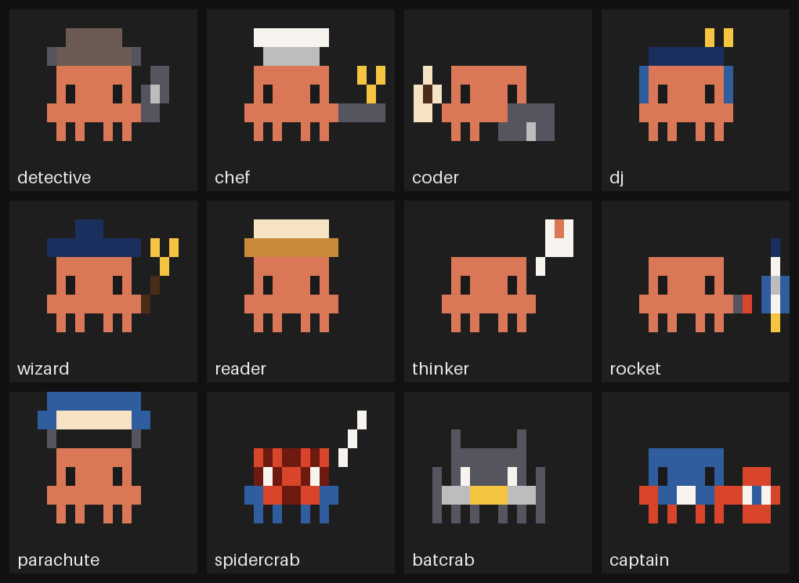

# clawd-pet

A pixel Clawd pet for Claude Code. It lives in a small bar above the prompt: it walks, talks, reacts to what Claude is doing, and can be picked up, thrown and stunned. It also dresses up in 17 costumes.



## Install

At the prompt of a Claude Code terminal session:

```
/plugin install clawd-pet --marketplace miyxotkem/clawd-pet
```

Answer `y` to add the marketplace, then pick a scope (user scope loads it in every session).

From a shell:

```bash
claude plugin install clawd-pet --marketplace miyxotkem/clawd-pet
```

In the Claude desktop app, where `/plugin` does not run: click **+** next to the prompt box, then **Plugins**, **Add marketplace** with `miyxotkem/clawd-pet`, then **Add plugin**.

## What it does

- **Walks and talks.** Clawd crawls around its bar, blinks, chats now and then, greets you by time of day, and falls asleep when things are quiet.
- **Reacts to Claude.** It says "On it!" when you send a prompt, comments on the tools Claude uses, taps its arms while Claude works, and jumps when a turn finishes. After two minutes on one turn it starts to sweat, and when a turn fails it wears a bandage.
- **Thinks as hard as Claude.** While Claude works, thinking dots fill up beside Clawd's head: one slow dot on low effort, up to five quick yellow ones on max. When you change the effort level, Clawd says so on the next turn, with a jump when it goes up.
- **Types along.** While you type in the prompt box, Clawd stops wandering and taps away with you, then goes back to its business a few seconds after you stop.
- **Helper crabs.** Each subagent Claude starts brings a small crab that walks beside Clawd until the subagent returns (up to three at once).
- **Commits, pushes and tests.** Clawd puts on a party hat for `git commit`, launches the rocket for `git push`, and shakes pom-poms while tests run (`npm test`, `pytest`, `cargo test` and the like). When the command finishes it cheers, or looks sad if it failed.
- **Drag and throw.** Grab Clawd and move it, even up over the bars above the prompt. It measures those bars, so it rises exactly as high as they reach. Let go and it falls back down; drop or fling it hard and it lands stunned, with stars. Every third high drop, it opens a parachute instead.
- **Cosplay.** By default Clawd dresses for Claude's work: a thought bubble while thinking, a book for reading files, a chef's hat for edits, a deerstalker for searches, a wizard hat for commands, a laptop and coffee for other tools, a rocket when a turn is done, and headphones when idle.
- **Model suits.** Clawd wears a suit for the model the chat runs on, and changes when you switch with `/model`: the spidercrab suit on Opus 5.5, the batcrab suit on Haiku 5.5, the captain suit on Sonnet 5.5.
- **Holidays.** Between jobs, a holiday outfit takes the suit's place: a pumpkin from October 24 to 31, a Santa hat from December 1 to 26, and a mai blossom with a lì xì envelope for a week either side of Tết.

<details>
<summary>A secret</summary>

Put the word **ultracode** in a prompt. Clawd drops its costume, charges up, and transforms: rings of light race out across the whole bar, armor builds from its legs up, and a flash ends it in white armor with a glowing visor. The hero flies over the bars above instead of walking, and while Claude is idle it patrols, firing missiles from its back at the sky (fireworks) and the ground (blasts and smoke). Move the pointer over the other bars and it drops low for a while so you can click them. The next prompt without the word takes the armor off, and if Clawd is in the air, it parachutes down.

</details>

## Commands

| Command | What it does |
| --- | --- |
| `/clawd` | Show Clawd |
| `/clawd hide` | Hide Clawd |
| `/clawd <text>` | Make Clawd say something |
| `/clawd cosplay` | List the costumes |
| `/clawd cosplay <costume>` | Wear one costume until you change it |
| `/clawd cosplay auto` | Dress for Claude's work again (the default) |
| `/clawd cosplay off` | No costumes |
| `/clawd cosplay demo` | Show every costume in turn, about 3 seconds each |

Costumes: `detective`, `chef`, `coder`, `dj`, `wizard`, `reader`, `thinker`, `rocket`, `parachute`, `spidercrab`, `batcrab`, `captain`, `party`, `cheer`, `santa`, `pumpkin`, `tet`.

## Development

The mod is a Claude Code hooks module: `hooks/register.tsx` reacts to Claude's events and draws the bar, and `hooks/clawd.tsx` animates Clawd in it. Run the tests with:

```bash
claude plugin test .
```

## Notes

This is an unofficial fan project, not made by or affiliated with Anthropic.

## License

MIT
